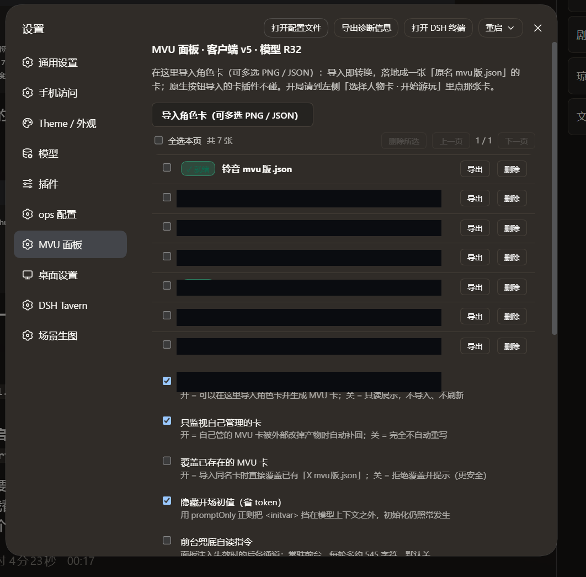
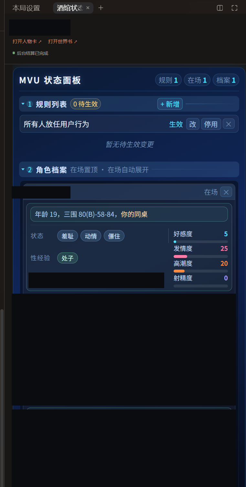

# dsh-tavern-mvupanel

给 [DSH Tavern](https://github.com/flizzywine/dsh-tavern) 用的 **MVU 面板插件**：在 Tavern 的「设置 → MVU 面板」里导入人物卡，
插件用纯程序把它转换成**可以直接开局的 MVU 卡**——开场自带 `<initvar>` 与面板入口，后台结算按规则更新变量，
正文里的面板读变量显示状态。

- **零模型调用**：转换是字符串与 JSON 处理，不花一分钱、不占一次请求。
- **初始化零 token**：`<initvar>` 只留在开场里，用 `promptOnly` 正则挡在模型上下文之外；面板 HTML 与
  `<mvu-status/>` 同样不进上下文。常驻进上下文的只有后台结算规则（只喂结算模型）与可选的兜底自读指令。
- **与原生导入彻底隔离**：插件只认自己导入的卡，不扫描 `cards/`，原生按钮导入的卡一字节都不碰。



> 设置 → **MVU 面板**：上方是导入按钮与卡片列表，下方是开关与规则档位。
> 图中人物卡名已用黑条覆盖；截图取自客户端 v4，v5 起每行按钮为「导出 / 删除」。

## 为什么做成「插件页导入」

Tavern 的插件接口（第 2 版）目前没有开放：卡片列表的行内按钮、同源卡合并显示、以及「用某张卡开局」的 API。
所以插件**改不了**原生「选择人物卡 · 开始游玩」窗口。本插件把「导入 + 转换」整体搬进自己的设置页，
原生窗口只负责显示与开局——没有任何接口外的手段去动 Tavern 的界面。

## 安装

1. 把本仓库整个文件夹放进 Tavern 数据目录的 `plugins/` 下，目录名保持 `dsh-tavern-mvupanel`：

   ```text
   <tavern data>/plugins/dsh-tavern-mvupanel/
   ├─ package.json
   ├─ index.mjs         宿主半
   ├─ client.js         浏览器半
   ├─ lib/              转换引擎、卡片读写、导入链路、设置
   └─ assets/           面板 HTML/CSS/JS、绑定表、状态 schema、两档结算规则
   ```

   `<tavern data>` 是 Tavern 的数据目录（命令行版通常是 `~/.dsh/profile-data/tavern/data`，
   设置过 `DSH_HOME` 时是 `$DSH_HOME/profile-data/tavern/data`；桌面版在 DSH 数据目录下的
   `harness/profile-data/tavern/data`）。

2. **重启一次 DSH**。插件是运行中新放进 `plugins/` 的，Tavern 先登记、再加载，中间需要一次重启。

3. 打开 设置 → **MVU 面板**。出现这一节就装好了。

需要 DSH Tavern **2.5.0+**（插件接口第 2 版）；已在 DSH 0.1.5-rc.2 / Tavern 2.6.0 上验证。

不需要 `npm install`，不需要任何 bundle 补丁：本插件走 `plugins/` 文件夹加载，与 `profiles/*/node_modules` 无关，
也没有任何第三方依赖。

## 使用

**导入**：设置 → MVU 面板 → 「导入角色卡（可多选 PNG / JSON）」。每张卡的处理结果会列出来
（`已转换` / `未导入 + 原因`）；全部成功后记录行 6 秒自动收起，有失败则保留。

导入的结果**只有一张卡**：`cards/<原名> mvu版.json`。文件名带 ` mvu版` 后缀是为了永不与
「你用原生按钮导入的同名卡」撞名，也不会覆盖你自己的卡。你上传的原始文件会留一份在插件目录
`backups/imported/`。

**开局**：到左侧「选择人物卡 · 开始游玩」里点那张卡（原生窗口每次打开都会重新列卡，不需要刷新）。

**列表**：默认 15 条一页。每行 = 勾选框 + 就绪状态 + 文件名 + `导出` + `删除`；上方有
`全选本页` / `删除所选` / `上一页` / `下一页`。

| 开关 | 作用 |
| --- | --- |
| 启用插件页导入 | 关掉后只读展示，不导入、不刷新 |
| 只监视自己管理的卡 | 开 = 自己管的卡产物被外部改掉时自动补回；关 = 完全不自动重写 |
| 覆盖已存在的 MVU 卡 | 开 = 导入同名卡时直接覆盖；关 = 拒绝并提示（默认，更安全） |
| 隐藏开场初值（省 token） | 用 `promptOnly` 正则把 `<initvar>` 挡在模型上下文之外 |
| 前台兜底自读指令 | 面板注入失效时的后备通道；常驻前台，每轮多约 545 字符，默认关 |

**导出**：把这张卡导出成 `.json` 下载（可以直接在 Tavern 里再导入）。卡片大到超过单次返回上限
（约 3.5 MB）时，插件会把文件写到自己的 `exports/` 并在提示里给出路径。

**删除**：单张或批量删除都**不留底**（刻意的：导入时的原始文件已在 `backups/imported/`）。

## 生成的卡里有什么

| 产物 | 说明 |
| --- | --- |
| 三条具名正则 | `dsh-mvu-status-view`（`<mvu-status/>` → 面板 HTML，`markdownOnly`）、`dsh-mvu-hide-marker`（`promptOnly` 隐藏入口）、`dsh-mvu-hide-initvar`（`promptOnly` 隐藏初值） |
| 三条世界书条目 | `[initvar]状态初值`（停用，0 token）、`[mvu_update]状态更新规则`（常驻，只喂后台结算）、`[rules_inject]规则注入（占位）`（停用，供面板定向清洗） |
| 开场 | 每个开场末尾追加 `<initvar>{…}</initvar>` 与 `<mvu-status/>` |
| 记账 | `extensions.dsh_mvu_conversion`：面板 HTML、绑定表、状态 schema、结算规则、修订号、导入来源 |

每轮进入模型上下文的成本（默认设置）：面板 HTML 与标记 **0**、开场初值 **0**（`promptOnly` 隐藏）、
后台结算规则只喂结算模型、不占前台。

## 面板与变量（修订 R32）



> 面板实际长相：蓝 = 本轮临时状态，青绿 = 性经验，紫粉 = 性癖；右侧四条数值轴 =
> `好感度` / `发情度` / `高潮度` / `射精度`。图中人物卡名、角色名与成人内容已用黑条覆盖。

- **档案卡 23 字段**，分三类：长期（跨轮保留）/ 临时（本轮有效，离场清空）/ 标记（在场）。
- **数值区 4 轴**：`好感度`、`发情度`、`高潮度`、`射精度`。
  `射精度` 是交合中男性对象（通常是你）的射精累积进度；`高潮度` 与 `射精度` 双双进入临界时，
  下一轮让双方同时高潮 / 射精。
- **性经验** = 主档位（`处子` → `开苞` → `经验丰富`，单向推进）+ 7 类累积标签
  （身体开发 / 行为 / 高潮 / 器具与准备 / 露出与公众 / 生育 / 调教与标记），
  每类都写明「什么算这一类」的判据与规范词映射（只写规范词，老标签保持原样）。
- **身体四字段**带**腔道归属硬映射**：正文作用在哪个腔，就只覆写它对应的那一个字段（后庭侧绝不写进前面的那个），
  并附可执行的自检条件。字段名见下面的折叠块。
- **后台结算规则两档**：完整档带解释与示例，精简档保留全部契约、去掉举例。

> 面板的字段表、数值轴刻度、性经验词表、规则列表四个按钮与常见问题，见 **[面板使用手册](docs/panel-manual.md)**。

<details>
<summary>身体四字段的完整字段名（含成人用词，点击展开）</summary>

`胸部`、`臀部`、<span style="color:#0d1117;background-color:#0d1117">小穴</span>、<span style="color:#0d1117;background-color:#0d1117">菊穴</span>

</details>

## 目录结构

| 文件 | 作用 |
| --- | --- |
| `index.mjs` | 宿主半：`ctx.tavern.handle` 暴露命令（状态 / 导入分块 / 导出 / 删除 / 日志），定时巡检自己管的卡 |
| `client.js` | 浏览器半：设置区一节 + 侧栏面板；文件导入、分块上传、列表、批量删除、导出 |
| `lib/import.mjs` | 导入链路、台账、日志、导出、收养与清点 |
| `lib/cardfile.js` | 卡片文件读写（接口外的两处 IO 之一，另一处在 `lib/import.mjs`） |
| `lib/artifacts.js` | 转换引擎：注入正则 / 世界书 / 开场初值 / 记账（纯函数，无 IO） |
| `lib/options.mjs` | 插件自己的设置（`options.json`） |
| `assets/*` | 面板 HTML/CSS/JS、绑定表、状态 schema、两档结算规则 |
| `test/run.mjs` | 自检：不需要 Tavern 与真实卡 |
| `docs/` | 已脱敏的截图与 [面板使用手册](docs/panel-manual.md) |

## 排查

- **宿主日志**：`<DSH data>/desktop/logs/host/dsh-<日期>.log`，搜 `dsh-tavern-mvupanel`。
  启动时会打印 `已就绪（模型 R32）…` 与 `导入桥已注册：{…}`；看到后者说明 Tavern 接口第 2 版可用。
- **插件自己的日志**：插件目录 `logs/mvupanel-<日期>.jsonl`（按天、单日 2 MB、保留 7 天）。
  面板底部的「最近日志」显示内存里的最近 60 条，「复制日志」一次取走 200 行。
- 设置页点开空白：多半是老版本 Tavern 不支持往设置区注册一节（需要接口第 2 版）。
- 导入后原生窗口里没看到卡：确认 `cards/` 下确实生成了 `<原名> mvu版.json`；原生窗口每次打开都会重新列卡。

## 卸载与回滚

1. 删除插件文件夹（插件不再运行；已经生成的 MVU 卡保持原样，可以继续玩）。
2. 已经生成的卡：用面板的「删除」，或直接删 `cards/<原名> mvu版.json`。
3. 想回到导入前的原始卡：插件目录 `backups/imported/` 里有你上传的那一份。

## 自检

```bash
node test/run.mjs
```

23 项检查：导入、重名保护、覆盖导入、产物结构（面板修订 / 23 字段 / 具名正则 / 三条世界书条目 /
腔道映射）、导出往返、台账、删除、卡片被外部删掉后台账自动清理。不需要 Tavern，也不联网。

## 权限与边界

见 [PERMISSIONS.md](PERMISSIONS.md)。一句话版本：**零依赖、零联网、零子进程、零凭据、零模型调用**；
唯一越出插件接口的部分是人物卡文件的读写（接口还没有开放），它被隔离在 `lib/import.mjs` 与
`lib/cardfile.js` 两个文件里，未来 Tavern 开放接口时只需替换这两个文件。
